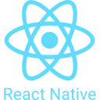
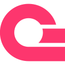

<p align="center">
  <b>Software Engineer · Backend Engineer · AI Builder · Systems Thinker</b>
</p>

<p align="center">
  I build fast, secure, scalable software that solves real problems.
</p>

<p align="center">
  <a href="YOUR_PORTFOLIO_URL">Portfolio</a> ·
  <a href="YOUR_LINKEDIN_URL">LinkedIn</a> ·
  <a href="YOUR_X_URL">X</a> ·
  <a href="YOUR_BLOG_URL">Blog</a> ·
  <a href="mailto:YOUR_EMAIL">Email</a>
</p>

---

## About

I build fast, secure, production-grade software that makes an impact.

Currently on a journey to become one of the best technologists in the world by continuously improving how I **design, build, secure, scale, and reason about software systems**.

I believe great technology is built on three pillars:

**Security · Scalability · User Experience**

Every project I take on is guided by those principles.

I thrive in environments where I can solve difficult problems, learn quickly, collaborate with ambitious people, and turn ideas into reliable software.

---

<h1 align="center">Currently</h1>

<table>
  <tr>
    <td align="center" width="33%">
      <h3>🔭 Building</h3>
      <p>MELVIS AI</p>
    </td>
    <td align="center" width="33%">
      <h3>🧠 Exploring</h3>
      <p>Distributed Systems & AI Engineering</p>
    </td>
    <td align="center" width="33%">
      <h3>✍️ Sharing</h3>
      <p>Engineering knowledge & technical writeups</p>
    </td>
  </tr>
</table>

---

<h1 align="center">Valuable Skills</h1>

<details>
<summary><b>System Architecture & Scalability</b></summary>

<br>

I design systems that don't break when real users show up.

I work with concepts such as modular architectures, microservices, event-driven systems, asynchronous processing, caching, database optimization, horizontal scaling, queues, fault tolerance, and distributed system design.

My goal is not simply to make software work — but to make it **reliable, maintainable, observable, and capable of evolving**.

</details>

<details>
<summary><b>AI-Driven Development</b></summary>

<br>

I use AI as an engineering multiplier rather than a replacement for engineering judgment.

I explore AI-assisted workflows for:

* Code generation
* Test generation
* Documentation
* Code reviews
* Commit messages
* Debugging
* Developer productivity
* Knowledge retrieval
* Intelligent automation
* AI-powered applications

I am particularly interested in building software where AI becomes part of the product itself.

</details>

<details>
<summary><b>Security-First Engineering</b></summary>

<br>

Security is part of the architecture — not an afterthought.

I actively consider threats such as:

* SQL injection
* XSS
* CSRF
* Broken authentication
* Broken authorization
* Insecure APIs
* IDOR
* Misconfiguration
* Sensitive data exposure
* Weak permission models
* Improper input validation

I aim to build systems where secure defaults are part of the development process.

</details>

<details>
<summary><b>Backend Engineering</b></summary>

<br>

I am passionate about building secure, scalable, high-performance backend systems.

I focus on:

* API design
* Database architecture
* Authentication & authorization
* Distributed services
* Asynchronous processing
* Real-time systems
* Caching
* Performance optimization
* Error handling
* Observability
* Maintainable application architecture

</details>

<details>
<summary><b>Problem Solving & Engineering Thinking</b></summary>

<br>

I enjoy breaking complex problems into smaller systems that can be understood, tested, optimized, and evolved.

I care about:

* Understanding the problem before writing code
* Choosing appropriate abstractions
* Reasoning about trade-offs
* Measuring before optimizing
* Designing for failure
* Reducing unnecessary complexity
* Writing software that other engineers can understand

</details>

---

<h1 align="center">Featured Projects</h1>

<p align="center">
  A selection of systems, products, experiments, and engineering projects I've built.
</p>

<table>
  <tr>
    <td width="50%" valign="top">

### 🤖 MELVIS AI

**Multifunctional Enhanced Learning Virtual Intelligence System**

An AI-powered personal assistant and developer environment designed to combine conversational AI, automation, voice interaction, local models, and intelligent workflows.

**Stack:** Python · FastAPI · Ollama · AI · Playwright · OpenCV

<a href="YOUR_MELVIS_REPO">Repository</a> · <a href="YOUR_MELVIS_DEMO">Demo</a>

```
</td>

<td width="50%" valign="top">
```

### 🛡️ SignalHQ

**Incident Management Platform**

A production-oriented incident management system inspired by platforms such as PagerDuty, Jira, and Statuspage.

Designed around incident reporting, triage, assignment, resolution, RBAC, real-time updates, and operational workflows.

**Stack:** React · TypeScript · NestJS · PostgreSQL · Docker

<a href="YOUR_SIGNALHQ_REPO">Repository</a> · <a href="YOUR_SIGNALHQ_DEMO">Demo</a>

```
</td>
```

  </tr>

  <tr>
    <td width="50%" valign="top">

### 🎬 EpicScreen

**Movie Discovery & Streaming Simulator**

A frontend engineering project designed to demonstrate asynchronous JavaScript through a real-world movie experience.

Explores XHR, HTTP requests, events, Promises, concurrency, error handling, and asynchronous workflows.

**Stack:** HTML · CSS · JavaScript · XHR · Promises

<a href="YOUR_EPICSCREEN_REPO">Repository</a> · <a href="YOUR_EPICSCREEN_DEMO">Demo</a>

```
</td>

<td width="50%" valign="top">
```

### 🔄 CollabFlow

**Real-Time Collaboration Platform**

A collaborative platform designed around real-time communication, authentication, project workflows, and distributed backend services.

**Stack:** Next.js · NestJS · PostgreSQL · MongoDB · Redis · WebRTC

<a href="YOUR_COLLABFLOW_REPO">Repository</a> · <a href="YOUR_COLLABFLOW_DEMO">Demo</a>

```
</td>
```

  </tr>

  <tr>
    <td width="50%" valign="top">

### 💳 MRE Wallet Engine

**Financial Ledger & Wallet System**

A backend-focused wallet engine designed around transactional integrity, ledger-based accounting, balances, and financial operations.

**Stack:** Java · Spring Boot · PostgreSQL

<a href="YOUR_WALLET_REPO">Repository</a>

```
</td>

<td width="50%" valign="top">
```

### 📊 Investment Dashboard

**Investment Intelligence Platform**

A dashboard focused on presenting investment information through a clean, interactive interface with an emphasis on data visualization and user experience.

**Stack:** React · TypeScript · Data Visualization

<a href="YOUR_INVESTMENT_REPO">Repository</a> · <a href="YOUR_INVESTMENT_DEMO">Demo</a>

```
</td>
```

  </tr>

  <tr>
    <td width="50%" valign="top">

### 💰 Smart Saving

**Personal Savings Platform**

A financial application focused on helping users visualize, organize, and manage personal saving goals.

**Stack:** React · TypeScript · Frontend Engineering

<a href="YOUR_SMART_SAVING_REPO">Repository</a> · <a href="YOUR_SMART_SAVING_DEMO">Demo</a>

```
</td>

<td width="50%" valign="top">
```

### 🧰 Dev Tools Hub

**Developer Productivity Toolkit**

A collection of practical developer utilities designed to reduce repetitive tasks and improve everyday development workflows.

**Stack:** TypeScript · React · Web APIs

<a href="YOUR_DEVTOOLS_REPO">Repository</a> · <a href="YOUR_DEVTOOLS_DEMO">Demo</a>

```
</td>
```

  </tr>

  <tr>
    <td width="50%" valign="top">

### 📝 OpenBlogX

**Modern Publishing Platform**

A developer-oriented publishing platform exploring content management, authentication, APIs, and scalable application architecture.

**Stack:** Next.js · TypeScript · Backend APIs · Database

<a href="YOUR_OPENBLOGX_REPO">Repository</a> · <a href="YOUR_OPENBLOGX_DEMO">Demo</a>

```
</td>

<td width="50%" valign="top">
```

### 🧠 OOP Dojo

**Object-Oriented Programming Laboratory**

A learning-focused environment for practicing object-oriented programming, software design principles, patterns, and problem solving.

**Stack:** Programming Fundamentals · OOP · Software Design

<a href="YOUR_OOP_DOJO_REPO">Repository</a>

```
</td>
```

  </tr>
</table>

<p align="center">
  <a href="YOUR_PROJECTS_PORTFOLIO"><b>→ Explore all projects</b></a>
</p>

---

<h1 align="center">Architecture Lab</h1>

<p align="center">
  I don't just build applications. I study how systems behave.
</p>

<table>
  <tr>
    <td align="center">🏗️<br><b>System Design</b></td>
    <td align="center">⚡<br><b>Performance</b></td>
    <td align="center">🔐<br><b>Security</b></td>
    <td align="center">📡<br><b>Distributed Systems</b></td>
  </tr>
  <tr>
    <td align="center">🗄️<br><b>Data Architecture</b></td>
    <td align="center">🔄<br><b>Event Driven Systems</b></td>
    <td align="center">🧵<br><b>Concurrency</b></td>
    <td align="center">📈<br><b>Scalability</b></td>
  </tr>
</table>

### Problems I enjoy exploring

```text
• How would I design a system for millions of users?
• What happens when a dependency goes down?
• Where should caching exist?
• When should a system become asynchronous?
• How should services communicate?
• How do we prevent a database from becoming a bottleneck?
• How should authentication and authorization be designed?
• How can a system recover gracefully from failure?
• What should happen when two requests modify the same resource?
• Where should consistency be sacrificed for availability?
```

<a href="YOUR_ARCHITECTURE_REPOSITORY"><b>→ Explore my architecture experiments</b></a>

---

<h1 align="center">Engineering Principles</h1>

<table>
  <tr>
    <td align="center" width="33%">
      <h3>01</h3>
      <b>Design for Failure</b>
      <p>Systems should expect things to fail and recover gracefully.</p>
    </td>
    <td align="center" width="33%">
      <h3>02</h3>
      <b>Security by Default</b>
      <p>Security belongs in the design, not at the end of development.</p>
    </td>
    <td align="center" width="33%">
      <h3>03</h3>
      <b>Keep Complexity Intentional</b>
      <p>Complexity should solve a real problem rather than create one.</p>
    </td>
  </tr>
  <tr>
    <td align="center">
      <h3>04</h3>
      <b>Measure Before Optimizing</b>
      <p>Performance decisions should be driven by evidence.</p>
    </td>
    <td align="center">
      <h3>05</h3>
      <b>Automate Repetition</b>
      <p>Computers should handle repetitive work whenever possible.</p>
    </td>
    <td align="center">
      <h3>06</h3>
      <b>Build to Evolve</b>
      <p>Good software should be able to change without collapsing.</p>
    </td>
  </tr>
</table>

---

<h1 align="center">Knowledge Matrix</h1>

<details>
  <summary><h2>Languages</h2></summary>

  <br>

          

</details>

<details>
  <summary><h2>Frontend</h2></summary>

  <br>

              

</details>

<details>
  <summary><h2>Backend</h2></summary>

  <br>

     

</details>

<details>
  <summary><h2>Database</h2></summary>

  <br>

        

</details>

<details>
  <summary><h2>Security</h2></summary>

  <br>

  

</details>

<details>
  <summary><h2>Tools</h2></summary>

  <br>

      

</details>

---

<h1 align="center">Engineering Notes</h1>

<p align="center">
  I write about programming, architecture, systems, security, and the lessons I learn while building.
</p>

<table>
  <tr>
    <td width="50%" valign="top">

### ⚙️ Memory Management Explained for Developers

Understanding how memory works, where allocations happen, and why memory-related problems matter.

<a href="YOUR_ARTICLE_URL">Read article →</a>

```
</td>

<td width="50%" valign="top">
```

### 🔄 How GitHub Actions Actually Execute Workflows

A practical look at workflow execution, runners, jobs, steps, and the underlying automation model.

<a href="YOUR_ARTICLE_URL">Read article →</a>

```
</td>
```

  </tr>

  <tr>
    <td width="50%" valign="top">

### ⚡ Understanding JavaScript Promises

Going beyond `.then()` and `.catch()` into concurrency, chaining, error propagation, and asynchronous control flow.

<a href="YOUR_ARTICLE_URL">Read article →</a>

```
</td>

<td width="50%" valign="top">
```

### 🧠 Engineering Notes

Experiments, system design thoughts, debugging lessons, and things I learn while building real software.

<a href="YOUR_BLOG_URL">Read more →</a>

```
</td>
```

  </tr>
</table>

---

<h1 align="center">Open Source</h1>

<p align="center">
  I believe software becomes better when ideas are shared, reviewed,
  challenged, and improved in public.
</p>

<p align="center">
  <a href="YOUR_GITHUB_REPOS">Repositories</a> ·
  <a href="YOUR_GITHUB_CONTRIBUTIONS">Contributions</a> ·
  <a href="YOUR_OPEN_SOURCE_PROJECTS">Open Source Projects</a>
</p>

---

<h1 align="center">What I Enjoy Building</h1>

<p align="center">

🏗️ Scalable Systems   ·  
🤖 AI Products   ·  
🔐 Secure Applications   ·  
⚡ Developer Tools

</p>

<p align="center">

📡 Real-Time Systems   ·  
💳 FinTech Systems   ·  
📊 Data Platforms   ·  
🌐 Web Applications

</p>

---

<h1 align="center">Currently Exploring</h1>

<table>
  <tr>
    <td align="center">Distributed Systems</td>
    <td align="center">AI Engineering</td>
    <td align="center">System Design</td>
  </tr>
  <tr>
    <td align="center">Cloud Infrastructure</td>
    <td align="center">Security Engineering</td>
    <td align="center">Performance Engineering</td>
  </tr>
</table>

---

<h1 align="center">GitHub Activity</h1>

<p align="center">

[](https://user-badge.committers.top/rwanda/Manzi-Elvis)

</p>

<table>
  <tr>
    <td width="33%" align="center" valign="top">
      
    </td>

```
<td width="34%" align="center">
  
</td>

<td width="33%" align="center">
  
</td>
```

  </tr>
</table>

---

<h1 align="center">Problem Solving</h1>

<p align="center">
  I continuously practice algorithms, data structures, and computational problem solving
  to strengthen the fundamentals behind the systems I build.
</p>

<div align="center">
  
</div>

<p align="center">
  <a href="YOUR_LEETCODE_PROFILE">View LeetCode Profile →</a>
</p>

---

<h1 align="center">Beyond the Code</h1>

<p align="center">
  Technology is only one part of engineering.
</p>

<p align="center">
  I care about continuous learning, communication, problem solving,
  creativity, leadership, and understanding how technology can create meaningful impact.
</p>

---

<h1 align="center">Let's Connect</h1>

<p align="center">
  Have an interesting engineering problem, ambitious project,
  open-source idea, or opportunity?
</p>

<p align="center">
  <a href="YOUR_LINKEDIN_URL">
    
  </a>
  &nbsp;&nbsp;
  <a href="YOUR_X_URL">
    
  </a>
  &nbsp;&nbsp;
  <a href="YOUR_BLOG_URL">
    
  </a>
</p>

<p align="center">
  <b>Let's build something meaningful.</b>
</p>

<p align="center">
  <a href="YOUR_PORTFOLIO_URL">Portfolio</a>
  &nbsp; · &nbsp;
  <a href="YOUR_LINKEDIN_URL">LinkedIn</a>
  &nbsp; · &nbsp;
  <a href="YOUR_X_URL">X</a>
  &nbsp; · &nbsp;
  <a href="YOUR_BLOG_URL">Blog</a>
</p>

---

<p align="center">
  <i>Build with purpose. Engineer with discipline. Keep learning.</i>
</p>
